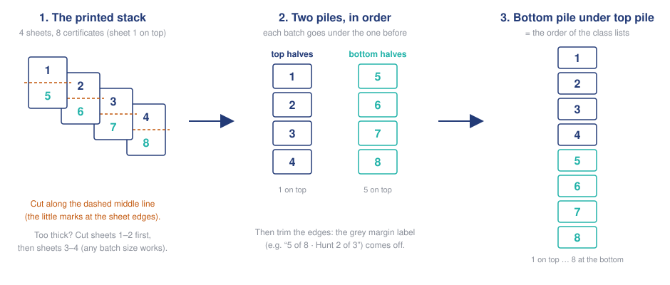

# Reading Challenge: how to do a round

Everything happens in the **Reading Challenge** app. It opens in your web browser, but it runs only on
this Mac: nothing goes on the internet except the scanned pages, which are sent to Claude to be read.

## How it works

Every scan, photo and form download goes into the **Scans** folder and stays there for good. The app keeps track
of which sheets are still waiting (the **Inbox**) and writes the list to **Inbox.txt** in the data folder, so you can
see it without the app. Every sheet waits until it's printed. When you're ready to hand things out,
**print a round**: the certificates and class lists for every sheet that's settled, for the month you pick
(last month, unless you change it). Anything still being sorted out just waits for the next round, and new sheets
can be added at any time, so a late sheet is never a problem: it goes in the next round.

Usually that's one big round early each month, and now and then a small one for stragglers.

(The first time the app opens after this change it may offer to **Move the months into the inbox**: press it once.
October becomes "October 2026 · round 1" and nothing else changes.)

## A round

1. **Scan** the sheets into one PDF (sheet-fed, one side, 300 dpi, colour or grey, *not* black and white, which
   loses pencil).
2. **Open Reading Challenge** (in Applications, or the Dock).
3. **Inbox → Add scans, photos or form CSV…** and choose:
   - the scanned PDF (the app puts the date in front of its name, e.g. "2026-11-12 Sheets.pdf", so names never
     repeat; you can also drop files straight into the Scans folder with Finder);
   - any sheets that came by email (photos are fine, including iPhone .heic);
   - the Google Form responses: in the response spreadsheet, File → Download → Comma-separated values (.csv).
     Every download has all the answers so far; add the new one with the same name and it replaces the old one.
     Answers already printed aren't used again, even if answers were deleted from the sheet and the rows moved.
   - Adding the same file twice is refused, even under a different name (and if it's dropped into Scans twice, the
     home screen says so). If a scan in the Scans folder is swapped for a different file with the same name, the
     home screen says so too, and no round can be printed until the original is put back (or the new one is added
     under its own name). Don't move or rename files in Scans: the history points at them.
4. **Read them** reads the new pages with Claude (about 3½ cents a page; a stack of ~50 sheets takes a couple of
   minutes). If it stops (Wi-Fi dropped), press it again: pages already read are kept.
5. **1 · Decide → Review sheets:** one row per sheet. Rows marked **needs a look** have a suggestion filled in,
   with the handwriting shown under each value.
   - **Enter** accepts the row and moves to the next one that needs a look. **↑ ↓** move between rows.
   - **Accept all suggestions** does every row whose suggestion is complete; look at the rest one by one.
   - A child with **two sheets** gets a choice under the pages: **Add** (each sheet has its own total),
     **Replace** (this sheet's total already includes the other), or **Skip** (the same sheet twice).
   - A child who **already got a certificate for that month** in an earlier round needs a choice:
     - **Accept**: count it for that month and **print their certificate again** with the whole month's pages. Use
       this when their certificate hasn't been handed out yet. On the class list they're marked "reprint" in orange,
       only the prizes that are new are listed to bag, and the margin label says "REPLACES EARLIER": swap it for
       the old one.
     - **Hold for a later round**: the certificate is already handed out, so it counts next month instead.
     - **Skip**: the same reading sent twice (e.g. a form and a paper sheet).
   - A sheet that names a month the child already has pages for (e.g. "October" when the round is for November)
     asks the same way: **Skip** if it's the same reading, **Accept** to count it for this round's month.
   - **Hold for a later round** (H) works on any sheet: it waits, settled, until you **Bring it back**.
   - A child who isn't on the list: choose **New student…** and their teacher. Their other sheets will then
     offer them by name.
   - **W** shows the whole scanned sheet.
   You don't have to settle everything: a round takes only what's ready. (A child with a sheet still open waits
   whole, so their sheets are never split across rounds by accident.)
6. **2 · Print a round** (home screen, or **Print round** at the top of the review): check the **Month** (it starts
   at last month), then press it. You get, under **Rounds printed**:
   - **Print this** (certificates.pdf): the one file to print, at **100% / actual size** (not "2 pages per sheet").
     - **Page 1 is the class lists** (sometimes 2 pages): what to bag for each child, class by class, the whole
       school's prize count at the top (for pulling prizes from stock), and anything **owed** from earlier.
       Lift it off before cutting.
     - **Then the certificates, two per sheet**, every sheet full. See **Cutting** below: after one cut they're in
       the order of the class lists, class after class.
   - **Summary**: the prize totals, and at the top **Checks: all passed**. If it says **FAILED**, don't
     print it yet: ask for help.
   - **Spreadsheet** (checkpoint.xlsx): everyone's totals. The **Sheets** tab has a row for every sheet in the
     round, so any certificate can be checked against its sheet.

   The prizes on a round's class lists count as **handed out** once it's printed. If one never reached the child,
   open their page under **Students** and press **Not handed out** next to it: it goes back on the next round's list,
   marked "(owed)".

## Cutting

Print the file at **100% / actual size** on letter paper, take the class list page(s) off, then:

1. **Cut the whole certificate stack across the middle** (the little marks at the left and right edges show
   where).
2. **Too thick for the cutter?** Cut a few sheets at a time, starting from the top of the stack. Put each batch's top
   halves on one pile and its bottom halves on another, each batch **under** the one before, so both piles stay
   in printed order.
3. **Put the bottom pile under the top pile.** The certificates are now in the order of the class lists: the first
   class's children in list order, then the next class, and so on. The classes follow each other in one stack, so
   split it where the teacher's name in the margin changes.
4. **Trim the edges.** The small grey label in the margin ("5 of 8 · Hunt 2 of 3": 5th of 8 overall, 2nd of 3 in
   Hunt's class) is there to put a dropped pile back in order; it comes off with the trim.

## If a round was wrong

Press **Undo…** next to the latest round. Its certificates, prizes and new students are cancelled (they stay in the
history, crossed out), its files move to an "(undone …)" folder, and its sheets go back to the inbox with every
choice you made: fix what was wrong and print the round again. Only the latest round can be undone (a later round
started from its totals).

## Fixing one child

**Students** (top right) lists every child; type to find one. Their page shows every change that made their total,
newest first, each with who made it and where it came from (which scan page, photo, form answer or spreadsheet row).
To fix something, fill in only what's wrong under **Make a correction**, say why, and press **Record correction**.
Nothing is overwritten: the history shows the old value, the change, who and why. **Cancel** on any line undoes it
(it stays in the history, crossed out).

**By month** at the top of a child's page shows each month's pages, total and prizes, with a link to see the
actual sheet while it's still kept. A total shown with a (+number) was set to a different number just before that
month; History says why.

While reviewing a sheet, the open row shows that child's last few months and total, with **History →** to open their
page in a new tab.

If a correction means a child has passed a prize level they never got, the prize is listed as **owed** and goes on
the next round's class list, marked "(owed)".

## Teachers and grades

**Teachers** (top right) lists every class with its grade. A new student gets their teacher's grade, and a child who
moves class gets the new class's grade, so set each teacher's grade at the start of the year (or when a teacher
changes grades). The list shows the grades the children in each class have now; **Set N students to grade X** brings
the odd ones out into line, with the change kept in each child's history.

## Spot-checking

The summary lists a few sheets to compare with the scans: a random handful, every page whose number was
typed in or combined, the biggest prize winners, and anyone with 5,000+ pages in a month (often a running
total written in the monthly box).

## Old scans

Scans and photos stay in the Scans folder (so a child's page can always show their sheet). Totals,
history and certificates always stay.

## When it's closed

Press **Quit** (top right) when you're done, or just leave it. Everything is saved as you go.
